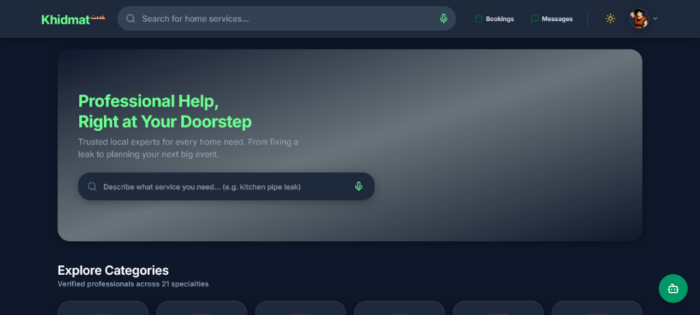
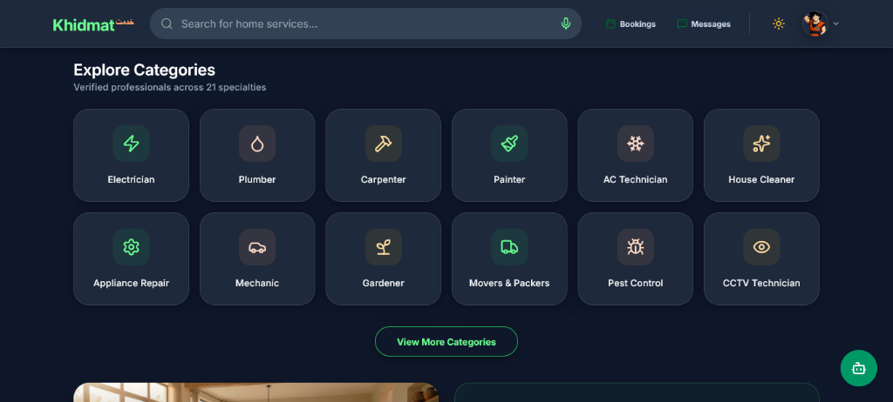
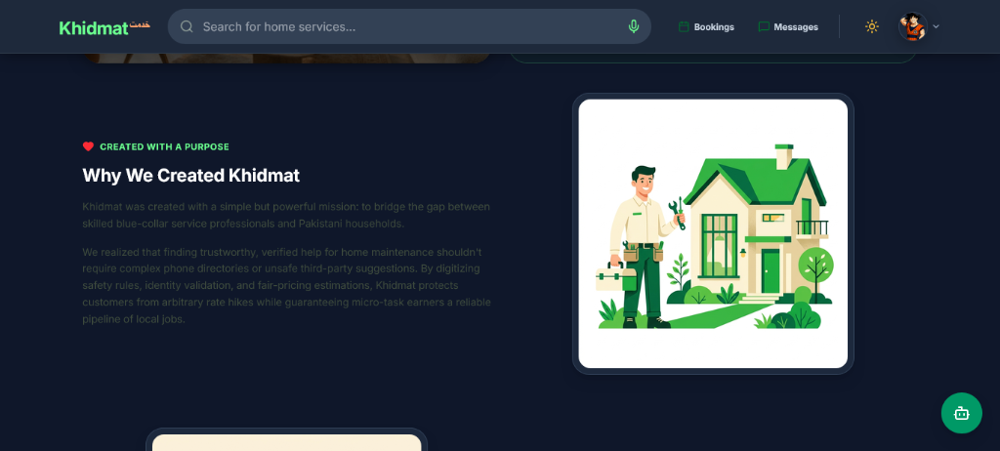
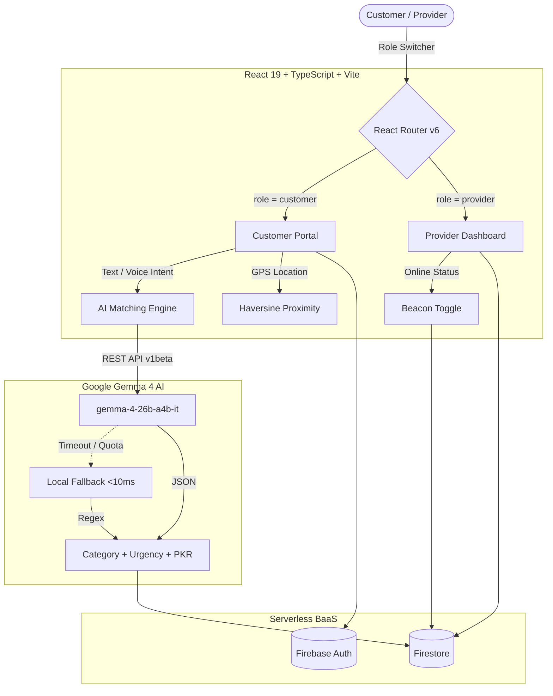

# Khidmat (خدمت) — Dual-Role Home Services Marketplace

> **One-liner**: Pakistan's dual-role home services platform where customers find trusted providers and providers grow their business — both powered by Google **Gemma 4** (`gemma-4-26b-a4b-it`) via the Gemini API.

---

## 📸 Interface Preview

| Hero & Voice Search | Service Categories | Why Khidmat |
|:---:|:---:|:---:|
|  |  |  |

> _Screenshots from the working app. If images don't render, the app is still fully functional — see "Running the Project" below._

---

## 🎯 Why Khidmat?

Pakistan's home services market is fragmented:
- **Customers** struggle to find trusted providers, fair prices, and verified identities.
- **Providers** (electricians, plumbers, gardeners, AC technicians) lack a steady job feed and pricing guidance.
- **The same person can be both** — an electrician who also hires a painter, or a homeowner who tutors on weekends.

Khidmat solves this with a **single dual-role account**, **AI-powered intent matching**, and **proximity-based ranking** — all running serverless.

---

## ✨ Core Features

| Feature | What it does |
|---|---|
| **Dual-Role Switcher** | 1-click toggle between **Customer** (search & hire) and **Provider** (job feed & earnings) in the same account. |
| **Gemma 4 Intent Parser** | Parses Roman Urdu / English queries (*"electrician chahiye Gulberg mein"*) into structured JSON: category, location, urgency. |
| **AI Fair-Price Estimator** | Suggests realistic PKR price ranges (e.g. `Rs. 700–1150`) with context. |
| **Proximity Ranking** | Uses browser geolocation + Haversine formula to rank nearby providers and calculate travel fees. |
| **Offline Fallback** | Deterministic local parser kicks in under 10ms if the API fails — **demo never breaks**. |
| **Real-time Chat** | Two-way messaging between customer and assigned provider. |
| **Provider Beacon** | InDrive-style online/offline toggle with GPS status. |

---

## 📁 Directory Structure (STR)

```text
khidmat_web_app-main/
├── docs/assets/               # UI Screenshots
├── scripts/                   # Development Utilities
├── src/
│   ├── components/            # UI primitives, auth guards & widgets
│   ├── contexts/              # AuthContext & Dual-Role Session
│   ├── hooks/                 # useAuth, useBookings, useProviders, useUserLocation
│   ├── layouts/               # Navbar (with Role Switcher), Footer, BottomNav
│   ├── pages/
│   │   ├── auth/              # Authentication (Customer / Provider)
│   │   ├── booking/           # ConfirmBooking, MyBookings
│   │   ├── chat/              # Chat & Inbox
│   │   ├── provider/          # ProviderHome (Dashboard), ProviderList, ProviderProfile
│   │   ├── AIMatching.tsx     # Voice radar & Gemma 4 matching
│   │   ├── Home.tsx           # Dynamic Root (Customer vs Provider)
│   │   └── Profile.tsx        # User Profile & Switcher Card
│   ├── services/
│   │   ├── firebase.ts        # Firestore, Auth, LocalStorage fallback
│   │   └── gemini.ts          # Gemma 4 REST integration & Fallback Parser
│   ├── test/                  # Vitest unit tests
│   ├── types/                 # Global TypeScript contracts
│   ├── App.tsx                # Lazy-loaded router
│   └── index.css              # Tailwind CSS v4
├── LICENSE                    # MIT License
├── package.json               # Dependencies & scripts
└── vite.config.ts             # Vite bundler config
```

---

## 🏗️ System Architecture (ARCH)



---

## 🚀 Running the Project

```bash
# 1. Install
npm install

# 2. Set up environment
cp .env.example .env
# Add VITE_GEMINI_API_KEY=your_key (get one at https://aistudio.google.com/apikey)

# 3. Run
npm run dev      # http://localhost:5173

# 4. Test & build
npm test
npm run build
```
