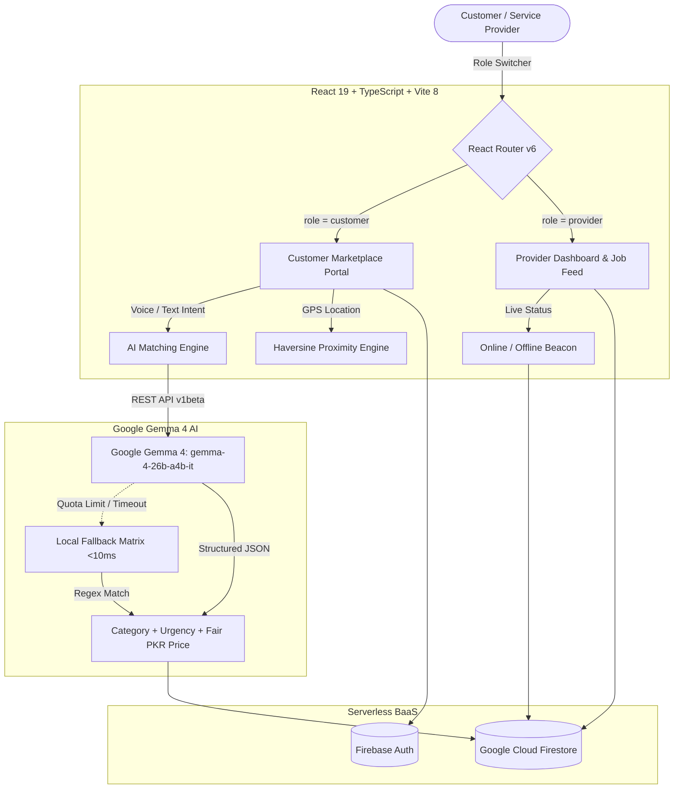

# Khidmat (خدمت) — On-Demand Home Services Marketplace

> **1-Line Pitch**: Pakistan's on-demand home services marketplace powered by Google Gemma 4 (`gemma-4-26b-a4b-it`) open-weight AI models for natural-language intent parsing, proximity-based provider ranking, and fair PKR price estimation.

---

## 📸 Application Interface Preview

| Hero & Voice Search | 21 Service Categories Grid | Why Khidmat & Verification |
|:---:|:---:|:---:|
|  |  |  |

## 🎯 Scope & Focus
This project was started before the hackathon. The authentication and database layers (Firebase Auth + Firestore) were pre-existing. During the hackathon, our focus was exclusively on the AI layer: integrating Google Gemma 4 (`gemma-4-26b-a4b-it`) for natural-language intent parsing, provider ranking, and PKR price estimation — with a graceful local fallback so the demo never breaks offline.

---

## 📜 Open Source & Model Licensing
* **Application Code**: Licensed under the [MIT License](./LICENSE).
* **AI Model Weights**: Powered by Google **Gemma 4 (`gemma-4-26b-a4b-it`)**, an open-weight model released under the [Apache 2.0 License](https://ai.google.dev/gemma/terms), accessed via the Gemini API.

---

## 📋 Previous Work Declaration
To maintain strict transparency regarding hackathon development guidelines, the breakdown of pre-existing foundation versus new work created during the event is detailed below:

| Dimension | Pre-Existing Prototype (Before Event) | Built During Hackathon (New AI Work) |
|---|---|---|
| **AI Integration** | None (Static regex keyword matchers only) | Integrated **Google Gemma 4 (`gemma-4-26b-a4b-it`)** open-weight model for natural-language Urdu/English intent parsing, proximity ranking, PKR price estimation, and prompt engineering |
| **Local Fallback Engine** | None | Built resilient offline fallback matrix (`localFallbackParser`) ensuring zero disruption if API quotas or network connections drop |
| **Architecture & Structure** | Monolithic files, single `SharedUI.tsx`, flat page hierarchy | Modular clean architecture: feature folders (`pages/auth`, `pages/booking`, `pages/provider`, `pages/chat`), decoupled UI primitives (`Card`, `Button`, `Input`, `Avatar`, `EmptyState`) |
| **Auth & Database** | Pre-existing Firebase Auth and Firestore schema (pre-built supporting infrastructure) | Reused as background plumbing so 100% of event development focused on AI capabilities |
| **Performance & Code-Splitting** | Eager bulk loading of all components | Implemented `React.lazy` + `Suspense` chunking with customized fallback loader |
| **State & Reusability** | Direct Firestore calls inside view components | Built custom reusable hook layer: `useAuth`, `useBookings`, `useProviders`, and `useUserLocation` |
| **Styling & Build Engine** | Legacy PostCSS configuration | Upgraded to official `@tailwindcss/vite` plugin with Tailwind v4 design tokens |
| **Quality & CI/CD** | No test runner or automated pipelines | Comprehensive Vitest + Testing Library test suite, JSDOM setup, and automated GitHub Actions CI workflow |

---

## 🌟 Key Features

### 1. Unified Search & Speech Recognition
* **Speech-to-Text Search**: Powered by the browser-native `SpeechRecognition` API. Users can search by speaking directly into the microphone.
* **Aesthetic Audio Visualizer**: Listening triggers an animated equalizer overlay.
* **Demo Shortcuts**: Includes quick-access chips for effortless live presentation testing.

### 2. Google Gemma 4 AI Intent Parser
* **AI Matching Engine**: Powered by Google Gemma 4 (gemma-4-26b-a4b-it), an open-weight model released under the Apache 2.0 license, accessed via the Gemini API.
* Analyzes plain text and voice transcripts (e.g. *"wiring inside the bathroom is sparking urgently"*).
* Invokes **`gemma-4-26b-a4b-it`** via Google Generative AI REST endpoints.
* Extracts structured JSON to categorize jobs across 21 local worker specialties, determine urgency (low, medium, high), and produce concise task summaries.
* **Intelligent Fallback**: Gracefully falls back to a local scoring matrix if no API key is provided or offline.

### 3. Automated Geolocation & Proximity Tracking
* Instant browser geolocation (`navigator.geolocation.getCurrentPosition`) coordinates tracking.
* Calculates actual travel distance (km) using the Haversine formula and computes automated travel allowances (Rs. 100 base + Rs. 20/km).

### 4. Gemma 4 AI Provider Matcher & Price Estimator
* **AI Ranking Engine**: Compares client coordinates with active specialists in their city, ranking candidates by proximity, customer ratings, completed jobs, and skills.
* **AI PKR Price Ranges**: Computes realistic service price ranges in Pakistani Rupees (PKR) with contextual market explanations.

### 5. InDrive-Style Availability & Dual-Role Experience
* **Online/Offline Switch**: Providers can toggle their visibility with a live status beacon.
* **Role-Based Portals**: Customers land on service discovery, while service providers land on a dedicated job dashboard tracking active requests, stats, and PKR earnings.

### 6. Real-Time Chat & Negotation
* Live two-way messaging between customers and assigned service providers using Firestore real-time listeners.
* **Dev Demo Board**: Development panel allowing one-click provider simulation replies and status transitions.

---

## 🎬 3-Minute Live Demo Flow for Judges
Follow this exact sequence for a seamless presentation that puts AI center-stage:

1. **Step 1: The Problem (0:00 - 0:20)**
   * Introduce Khidmat: Finding reliable, fair-priced local technicians in Pakistan is chaotic and unstructured. Customers struggle with pricing transparency and language barriers (Urdu / Roman Urdu).
2. **Step 2: Instant Entry (0:20 - 0:40)**
   * *"We're already logged in as a verified customer. Watch this —"* (Skip login friction entirely to dive straight into the AI experience).
3. **Step 3: AI Matching & Intent Parsing (0:40 - 2:10)**
   * Open `/matching` (or use voice/search chip on Home). Type or speak: *"electrician chahiye Gulberg mein"*.
   * **Gemma 4 in Action**: Watch the model parse the Roman Urdu request live into category (*Electrician*), location (*Gulberg*), and urgency (*High*).
   * **Proximity Ranking & PKR Pricing**: Transition to `/providers` showing real nearby specialists ranked with estimated PKR price ranges (e.g., `Rs. 700 - 1150`) based on local market rates.
4. **Step 4: Architecture & Open Weights (2:10 - 2:40)**
   * Explain how Google Gemma 4 (`gemma-4-26b-a4b-it`) is accessed via the Gemini API endpoints under the Apache 2.0 open-weight license.
   * Highlight the offline fallback architecture (`localFallbackParser`), guaranteeing the application never fails even in low-connectivity areas.
5. **Step 5: Booking, Chat & What's Next (2:40 - 3:00)**
   * Rapidly show one-click booking and live chat synchronization as supporting real-time infrastructure.
   * Wrap up with future roadmap: Voice-native Urdu audio processing with Gemma audio models and on-device lightweight execution.

---

## 🏗️ System Architecture

Khidmat is designed as a **Serverless, Dual-Role Event-Driven Architecture (EDA)** with an edge-resilient AI parsing pipeline:



---

## 📁 Project Directory Structure

```text
khidmat_web_app-main/
├── .github/workflows/          # CI/CD Automated Pipelines (Vitest, Build)
│   ├── ci.yml
│   └── auto-merge.yml
├── docs/                       # Project Documentation & Assets
│   ├── assets/                 # UI Screenshots for README
│   ├── ARCHITECTURE.md         # System Architecture deep-dive
│   ├── PRD.md                  # Product Requirements Document
│   └── CHANGES.md              # Detailed Changelog & History
├── scripts/                    # Development & Seed Utilities
│   ├── refactor.cjs            # Migration script
│   └── seedData.ts             # 21-category localized Pakistani mock database
├── src/
│   ├── components/
│   │   ├── auth/               # ProtectedRoute & Role Guards
│   │   ├── features/           # SiteAgentWidget & AI assistants
│   │   └── ui/                 # Atomic Primitives (Button, Card, Input, Avatar, etc.)
│   ├── constants/              # App-wide categories & Pakistani cities
│   ├── contexts/               # AuthContext & Dual-Role Session Management
│   ├── hooks/                  # Custom hooks (useAuth, useBookings, useProviders, useUserLocation)
│   ├── layouts/                # Navbar (with Role Switcher), Footer, BottomNav
│   ├── pages/
│   │   ├── auth/               # Auth.tsx (Login/Signup with role tabs)
│   │   ├── booking/            # ConfirmBooking.tsx, MyBookings.tsx
│   │   ├── chat/               # Chat.tsx, Inbox.tsx
│   │   ├── provider/           # ProviderHome.tsx (Dashboard), ProviderList.tsx, ProviderProfile.tsx
│   │   ├── AIMatching.tsx      # Voice scanning radar & Gemma 4 matching
│   │   ├── Home.tsx            # Dynamic Root (renders CustomerHome vs ProviderHome)
│   │   ├── Profile.tsx         # User Profile & Dual-Profile Switcher Card
│   │   ├── Categories.tsx      # 21 Categories Directory
│   │   └── Safety.tsx          # 5-step safety verification guide
│   ├── services/
│   │   ├── firebase.ts         # Firestore, Auth, and fallback LocalStorage DB
│   │   └── gemini.ts           # Google Gemma 4 REST integration & Local Fallback Parser
│   ├── test/                   # Vitest unit test suite
│   ├── types/                  # Global TypeScript contracts
│   ├── App.tsx                 # Lazy-loaded router configuration
│   ├── index.css               # Tailwind CSS v4 design tokens & cursor utilities
│   └── main.tsx                # React DOM entrypoint
├── LICENSE                     # MIT License
├── package.json                # Project dependencies & scripts
├── README.md                   # Project documentation
└── vite.config.ts              # Vite 8 + Tailwind v4 bundler configuration
```

---

## 🛠️ Complete Tech Stack

| Layer | Technology | Version | Purpose |
|---|---|---|---|
| **AI Intelligence** | **Google Gemma 4** | `gemma-4-26b-a4b-it` | Apache 2.0 open-weight model for Roman Urdu/English intent parsing, ranking, and fair PKR price estimation. |
| **Fail-Safe Fallback** | **Local Fallback Parser** | Built-in | Client-side rule matrix guaranteeing 100% demo uptime under low connectivity. |
| **Frontend Core** | **React** | `v19.0.0` | Modern component-based SPA architecture with Concurrent features. |
| **Language** | **TypeScript** | `v5.8.0` | Strict end-to-end type safety and compile-time verification. |
| **Build & Tooling** | **Vite** | `v8.1.3` | Next-generation frontend tooling with lightning-fast HMR and bundle optimization. |
| **Styling** | **Tailwind CSS** | `v4.0.0` | Modern CSS-first utility-driven styling engine with custom design tokens. |
| **Animations** | **Framer Motion** | `v12.4.7` | Production-grade physics animations, layout transitions, and audio equalizers. |
| **Routing** | **React Router** | `v6.30.0` | Declarative client-side routing with code-splitting via `React.lazy`. |
| **Icons** | **Lucide React** | `v1.16.0` | Crisp, scalable SVG icons for all 21 Pakistani service specialties. |
| **Speech Engine** | **Web Speech API** | Native | In-browser speech-to-text recognition for hands-free Urdu/English queries. |
| **Database & Auth** | **Firebase BaaS** | `v11.4.0` | Cloud Firestore real-time listeners and Firebase Auth sessions. |
| **Testing** | **Vitest + RTL + JSDOM** | `v3.0.7` | Modern test runner and component assertions. |

## ⚙️ Environment Variables Setup

Create a `.env` file in the root directory (optional — app runs in zero-config offline mode by default):

```properties
# Firebase Client Credentials (Optional - uses local mock DB if blank)
VITE_FIREBASE_API_KEY=your_api_key_here
VITE_FIREBASE_AUTH_DOMAIN=your_auth_domain_here
VITE_FIREBASE_PROJECT_ID=your_project_id_here
VITE_FIREBASE_STORAGE_BUCKET=your_storage_bucket_here
VITE_FIREBASE_MESSAGING_SENDER_ID=your_messaging_sender_id_here
VITE_FIREBASE_APP_ID=your_app_id_here

# Open-Weight AI (Google Gemma 4 — Apache 2.0)
# Model: gemma-4-26b-a4b-it
VITE_GEMMA_API_KEY=your_google_ai_studio_api_key_here
VITE_GEMINI_API_KEY=your_google_ai_studio_api_key_here
VITE_GEMMA_MODEL=gemma-4-26b-a4b-it
```

---

## 🚀 Running the Project

### 1. Install Dependencies
```bash
npm install
```

### 2. Run in Development Mode
```bash
npm run dev
```
Access the application at `http://localhost:5173/`.

### 3. Run Automated Tests
```bash
npm test
```

### 4. Build for Production
```bash
npm run build
```

---

## 📚 Documentation
Detailed project documents are located in [`docs/`](./docs):
* [Product Requirements Document (PRD)](./docs/PRD.md)
* [System Architecture](./docs/ARCHITECTURE.md)
* [Changelog & History](./docs/CHANGES.md)
